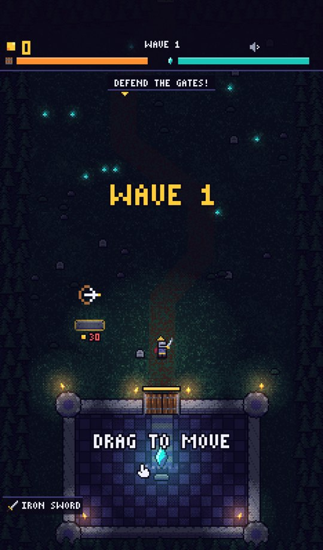
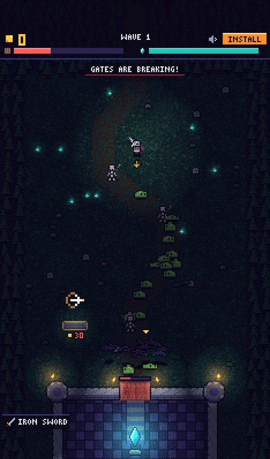
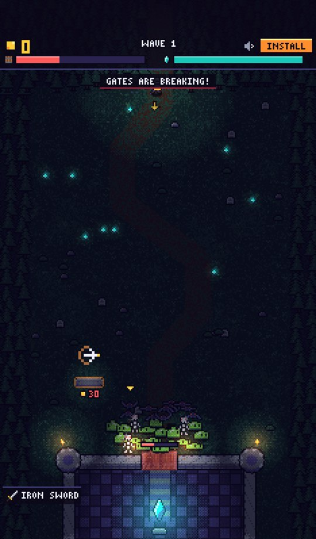

# Crystal Keep · Playable Ad

A night-time pixel-art defense playable: the hero holds the gates of a keep while waves of monsters come out of the forest for the crystal inside. Drag to move, the hero fights on his own, gold buys towers and better weapons.

**Play in the browser:** https://kib101d.github.io/crystal-keep-playable/

<p>
  
  
  
</p>

## Custom pixel art, all in code

There is not a single image file in the project. The hero, monsters, the keep, trees, torches and UI are pixel art drawn in code, with a night palette, pools of light around the torches and the crystal, and glowing wisps in the forest. The result is a distinct look that still weighs only 26–69 KB per build.

## Gameplay

- **Waves:** monsters walk down the forest path towards the gates; a boss arrives in later waves.
- **Fight:** drag anywhere to move the hero, attacks are automatic.
- **Gold:** pick it up from defeated monsters, then spend it:
  - towers: Archer Tower, Ballista, Frost Tower, Mage Tower;
  - weapons: Iron Sword → Battle Axe → Flame Glaive → Storm Hammer;
  - gate repairs when they start breaking.
- **Endings:** victory or a fallen crystal, both leading to the **Play now** end card.

## Ad-network builds

One game, packaged for every major network. Each build follows that network's specification:

| Build | Networks | Store call |
|---|---|---|
| `builds/mraid_applovin_unity_ironsource/index.html` | AppLovin, Unity, ironSource, Liftoff | `mraid.open`, picks Google Play or App Store by device |
| `builds/meta_moloco/index.html` | Meta, Moloco | `FbPlayableAd.onCTAClick()`, no MRAID |
| `builds/crystal_keep_google.zip` | Google Ads | `exitapi.js` in `<head>`, `ExitApi.exit()` |
| `builds/crystal_keep_tiktok.zip` | TikTok / Pangle | `config.json` + SDK, `window.openAppStore()`, no MRAID, no redirects, no HTTP requests |
| `builds/mintegral/crystal_keep.zip` | Mintegral | matching ZIP/folder/HTML names, `window.install()`, `gameReady()`, `gameEnd()`, `gameRetry()` |
| `index.html` | Preview | unminified, detects the network it runs in |

What was needed to pass the networks' review:

- **MRAID lifecycle (Unity, AppLovin):** the game waits for `ready`, starts only when the ad is viewable, and pauses together with the sound on `viewableChange`.
- **First touch:** the first tap never opens the store; INSTALL appears only after the player starts moving the hero.
- **Safe zones:** HUD and labels sit inside the area free from the network's own buttons at the top and bottom.
- **One adaptive build for portrait and landscape:** in landscape the sides are filled with forest instead of empty bars.
- **Minified output** (terser), 26–69 KB per build.
- **Meta and TikTok builds** have all MRAID and `window.open` code removed, as those networks require.

## Run locally

```bash
npx serve .
```

Open `index.html` for the preview build.
